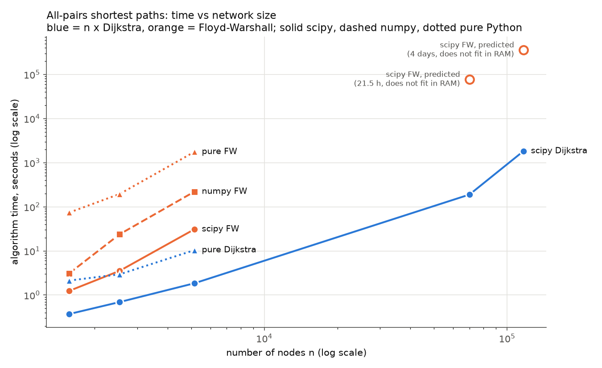
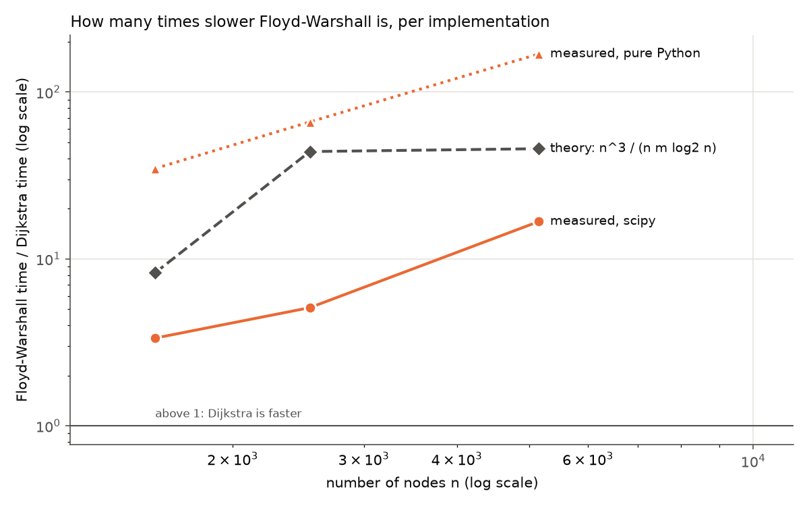
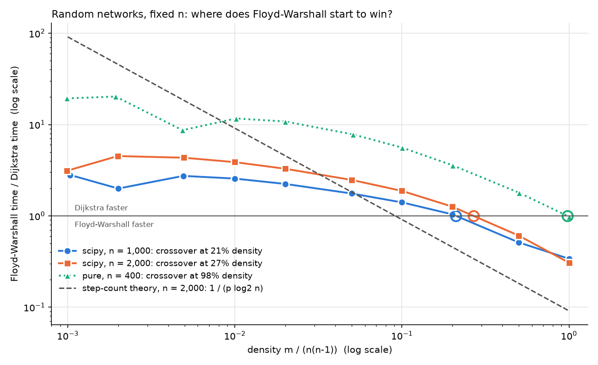

# All-pairs shortest paths: n x Dijkstra vs Floyd-Warshall on five real networks

**Abhimanyu Sharotry**  
MMIE 7372 Network Flows and Dynamic Programming, Fall 2026: Computational Study 1  
October 13, 2026

**AI assistance:** this study was carried out with substantial help from an AI coding assistant (Claude Opus 5.5 by Anthropic, used through Claude Code). The assistant wrote the code, ran the experiments and drafted this report under the author's direction; the author made the modeling and study-design decisions. Details in Section 12.

**Code, data sources and all results:** <https://github.com/absharotry/mmie.7372.001.NetFlow-DyProg.fall26/tree/main/computational-study-1-apsp>

## 1. Summary

We computed all-pairs shortest paths (APSP) on five real networks in two ways: by running
Dijkstra's algorithm once from every node ("n x Dijkstra") and by Floyd-Warshall (FW). Both were
implemented from scratch in Python (plus a vectorized numpy FW) and also run through the compiled
`scipy.sparse.csgraph` library. A controlled experiment on random networks then isolated the effect
of density.

- **n x Dijkstra was faster on every real dataset, in every implementation.** In the compiled
  (scipy) implementation, FW was 3.4x slower on US Airports, 5.1x on Adolescent Health and 16.7x on
  Advogato.
- **FW could not run on the two large networks** (Slashdot Zoo, n = 69,995; Wiki Conflict,
  n = 116,836). It must keep the full n x n distance table in memory: 36.5 GiB and 101.7 GiB,
  against 24 GiB of RAM. Even with enough memory, its measured speed predicts roughly 13-22 hours and
  4-6 days. n x Dijkstra finished them in 3.2 and 30.5 minutes (scipy) using at most 1.2 GiB. Our
  own pure-Python Dijkstra finished Slashdot in 24.8 minutes and Wiki Conflict in 8.0 hours.
- **The gap widens with network size.** FW's work grows as n^3 whatever the number of edges, while
  Dijkstra's grows with n x m, and all five networks are sparse (density 0.008% to 1.1%).
- **Density decides the winner.** On random networks with a fixed number of nodes, compiled FW
  only becomes faster than n x Dijkstra above about **21-27% density**. That is about 18-24 times
  denser than the densest real network studied (1.1%). In pure Python the crossover is at about **98%**.
- **Implementation changes the size of the gap, not the winner on the real data:** FW was 3.4x
  slower in scipy and 35x slower in pure Python on the same network.

## 2. Datasets and network characteristics

Raw data came from the sources named in the assignment (KONECT, Netzschleuder, Canvas). Download
URLs and SHA-256 checksums are in `data/SOURCES.md`. Each dataset needed decisions about what an
edge weight means as a distance; these are documented in `docs/decisions.md` (D1-D6) and summarized
here.

### 2.1 Raw data

| Dataset | Nodes | Edges (rows) | Directed | Weights |
|---|---|---|---|---|
| US Airports (2010) | 1,574 | 28,236 | yes | passengers per route (1 to 1,489,618) |
| Adolescent Health | 2,539 | 12,969 | yes | 1..6 = 1 + number of shared activities |
| Advogato | 6,541 | 51,127 | yes | trust level 0.6 / 0.8 / 1.0 |
| Slashdot Zoo | 79,120 | 515,397 | yes | +1 friend / -1 foe |
| Wiki Conflict | 118,100 | 2,917,785 | no | signed, +-ln(k) |

### 2.2 From weights to distances

- **Strength weights** (passengers, shared activities, trust): bigger means closer, so
  **distance = 1 / weight** (Opsahl, Agneessens and Skvoretz, 2010).
- **Signed weights** cannot be distances. Both signed networks contain negative cycles (Slashdot:
  4,497 pairs of users who mark each other as foes; Wiki Conflict: every negative edge, because the
  network is undirected), so shortest paths are undefined for *any* algorithm. Slashdot Zoo keeps
  friend edges only; Wiki Conflict keeps every interacting pair. Both use **hop counts**.
- Nodes with no links, self-loops and repeated edges are removed; none of them can change a
  shortest path.
- The assumptions behind these choices, and their potential issues (including fractional arc
  lengths after 1 / weight), are listed in Section 9.

### 2.3 Networks as used in the benchmark

| Dataset | n | m (one-way edges) | Density m / (n(n-1)) | Mean out-degree m/n | Max degree (out / in) | Reciprocity | Reachable ordered pairs | Distance |
|---|---|---|---|---|---|---|---|---|
| US Airports | 1,574 | 28,236 | 1.14% | 17.9 | 302 / 294 | 78% | 89.3% | 1 / passengers |
| Adolescent Health | 2,539 | 12,969 | 0.20% | 5.1 | 10 / 27 | 39% | 84.9% | 1 / weight |
| Advogato | 5,155 | 47,135 | 0.18% | 9.1 | 785 / 721 | 33% | 60.9% | 1 / trust level |
| Slashdot Zoo | 69,995 | 392,179 | 0.008% | 5.6 | 426 / 2,498 | 21% | 36.3% | hops (friend edges) |
| Wiki Conflict | 116,836 | 4,055,742 | 0.030% | 34.7 | 20,153 (undirected) | (undirected) | 93.8% | hops |

Wiki Conflict is undirected; each of its 2,027,871 editor pairs is stored as two one-way edges,
which is what the algorithms scan.

**Structure worth noting.** All five networks are very sparse. US Airports, Advogato, Slashdot and
Wiki Conflict have heavy-tailed degree distributions (a few hubs with hundreds to tens of thousands
of links). Adolescent Health has no hubs, because the survey limited each student to 10 friends.
Slashdot has low reachability: 41% of its users never tagged anyone as a friend, so no path starts
from them. Degree and weight distributions per dataset: `results/distributions_<dataset>.png`.

## 3. Implementations and method

### 3.0 The two approaches and their complexity

| | n x Dijkstra | Floyd-Warshall |
|---|---|---|
| Idea | single-source shortest paths from each node in turn; settle the closest unsettled node, relax its edges | dynamic programming over intermediate nodes: in sweep k, allow node k as a stop for every pair (i, j) |
| Time, binary heap | O(n m log n) | Theta(n^3), independent of m |
| Time, Fibonacci heap | O(n m + n^2 log n) | (same) |
| Memory | O(n + m) per source, if each row of results is processed and discarded | Theta(n^2): the whole distance table at all times |
| Edge weights | must be >= 0 | may be negative; negative cycles detected (negative diagonal) |

### 3.1 Implementations

| Version | n x Dijkstra | Floyd-Warshall |
|---|---|---|
| **pure** (our code, plain Python) | binary heap (`heapq`) with lazy deletion | textbook triple loop, k outermost |
| **numpy** (our code, vectorized) | (none: Dijkstra is sequential and does not vectorize) | k loop in Python; each sweep is one broadcast `np.minimum` over the whole table |
| **scipy** (`scipy.sparse.csgraph`, compiled) | `dijkstra` (Fibonacci heap) | `floyd_warshall` |

All versions were tested against networkx (Bellman-Ford) on a hand-checked graph and on random
graphs with zero weights, self-loops, multi-edges, negative edges and negative cycles (402 tests).

**Algorithm variants (stated explicitly, as they affect complexity or fairness):**
- Our pure Dijkstra uses lazy deletion instead of decrease-key: still O(m log n) per source.
- scipy's Dijkstra uses a Fibonacci heap: O(m + n log n) per source.
- scipy's Dijkstra only *warns* on negative weights and then re-processes nodes, which is no longer
  Dijkstra's algorithm. Our wrappers reject negative weights, so every Dijkstra timing here is
  genuine Dijkstra. (No dataset as used has negative weights.)
- On the hop-count networks (Slashdot, Wiki Conflict), breadth-first search would be the optimal
  single-source method. We time Dijkstra anyway, to compare like with like.
- Our pure-Python version is not entirely interpreted: Python's `heapq` is written in C, which
  favors Dijkstra among the pure-Python measurements.
- Our pure FW skips the inner loop when node i cannot reach node k (same result; still Theta(n^3) in
  the worst case). **scipy's FW evidently does the same**: on random networks with n = 1,000 it took
  0.005 s at 0.1% density but about 0.46 s at 2% density or more, while a strict triple loop would
  take the same time at every density. FW's real cost is therefore about n x (number of node pairs
  i, k with a path from i to k), at most n^3. Our numpy FW has no such skip.
- scipy's FW time includes converting the sparse input to a dense table (O(n^2), negligible next to
  n^3).

### 3.2 Measurement

- One measurement per **fresh Python process**, so peak memory belongs to that run alone.
- **Time = the shortest-path computation only.** Loading data and building the input are not timed.
- Short runs (< 10 s): one warm-up run, then **median of 5**. Longer runs: a single run.
- **Single thread** for every library.
- Dijkstra is run **streaming**: a batch of sources is solved, summarized and discarded, so the
  n x n table is never stored. Every run produces the same summary (number of reachable pairs, mean
  and maximum distance), which is how all versions are cross-checked at full scale.
- **Sampling as a check:** before the 8-hour full run of our pure Dijkstra on Wiki Conflict, we
  timed 1,000 randomly chosen sources (fixed seed) and scaled by n / 1,000: 7.65 h predicted. The
  full run took 8.00 h, 4.5% more, so sampling is a reliable way to estimate such runs.
- **Feasibility pre-check:** a run is not started if its estimated memory exceeds 60% of RAM. FW
  needs n^2 cells: 8 bytes each (scipy), 16 (numpy: table plus one temporary per sweep), up to 32
  (pure Python objects).
- Machine: Apple M2, 24 GiB RAM, macOS 26.7.1; Python 3.11.8, numpy 2.4.6, scipy 1.17.1.

## 4. Results on the five datasets

### 4.1 Running time

| Dataset | n | m | scipy Dijkstra | scipy FW | numpy FW | pure Dijkstra | pure FW |
|---|---|---|---|---|---|---|---|
| US Airports | 1,574 | 28,236 | 0.37 s | 1.25 s | 3.11 s | 2.13 s | 74 s |
| Adolescent Health | 2,539 | 12,969 | 0.70 s | 3.54 s | 24 s | 2.95 s | 3.3 min |
| Advogato | 5,155 | 47,135 | 1.85 s | 31 s | 3.7 min | 10.4 s | 29.3 min |
| Slashdot Zoo | 69,995 | 392,179 | **3.2 min** | infeasible | infeasible | **24.8 min** | infeasible |
| Wiki Conflict | 116,836 | 4,055,742 | **30.5 min** | infeasible | infeasible | **8.0 h** | infeasible |



"Infeasible" for numpy FW and pure FW on the two large networks follows from the same memory
check as scipy FW (they need 2 and up to 4 times as much memory: 73 GiB and more for Slashdot);
they were not submitted to the benchmark runner.

*Figure 1. Algorithm time against n (both axes logarithmic). Blue: n x Dijkstra; orange:
Floyd-Warshall. Hollow markers: predicted, not measured.*

### 4.2 How many times slower Floyd-Warshall is

| Dataset | Theory n^3 / (n m log2 n) | scipy | pure Python |
|---|---|---|---|
| US Airports | 8.3x | 3.4x | 35x |
| Adolescent Health | 44x | 5.1x | 66x |
| Advogato | 46x | 16.7x | 169x |



*Figure 2. FW time divided by Dijkstra time. Above 1 means Dijkstra is faster. The step-count
theory is shown for reference.*

### 4.3 Correctness

On each of the three small networks, all five versions found exactly the same number of reachable
pairs (2,209,653; 5,473,916; 16,177,614), and their mean distances agree to within 2e-15 (floating
point rounding). On Slashdot Zoo, our pure Dijkstra and scipy's both found exactly 1,777,768,126
reachable pairs with the same mean distance (4.8811). On Wiki Conflict, our pure Dijkstra and scipy's both found
exactly 12,796,704,262 reachable pairs (93.8%) with the same mean distance (3.3224). All reachable fractions match those computed independently from the network structure.

### 4.4 Memory

| Dataset | FW table (n^2 x 8 bytes) | Peak memory, scipy Dijkstra | Peak memory, pure Dijkstra |
|---|---|---|---|
| Advogato | 203 MiB | 440 MiB | 92 MiB |
| Slashdot Zoo | **36.5 GiB** (not run) | 801 MiB | 193 MiB |
| Wiki Conflict | **101.7 GiB** (not run) | 1,192 MiB | 1,173 MiB |

Pure Dijkstra, which handles one source at a time, never rose above the memory needed to hold the
network itself. On the small networks the scipy figures mostly reflect our 256 MiB batch size (the
whole n x n table fits in one batch there), so they do not separate the two algorithms; the decisive
memory evidence is the large networks. Full per-run table: `results/report_tables.md` (Table 3).

## 5. Runs that could not complete, explained by complexity

| Dataset | Version | Memory needed | Available (60% of 24 GiB) | Predicted time if it fitted (n^3 model / reachable-pairs model) |
|---|---|---|---|---|
| Slashdot Zoo | scipy FW | 36.5 GiB | 14.4 GiB | 21.5 h / 12.8 h |
| Wiki Conflict | scipy FW | 101.7 GiB | 14.4 GiB | 4 days / 6 days |

numpy FW (twice the memory) and pure FW (up to four times) are infeasible for the same reason.

**Why: memory.** FW works on the full n x n table. Each of its n sweeps reads and may update every
cell, so the whole table must stay in memory for the entire run: Theta(n^2) space, independent of
how many edges the network has. For n = 116,836 that is 13.65 billion cells, or 101.7 GiB at 8 bytes
each. Keeping the table on disk does not help: n sweeps over 36.5 GiB (Slashdot) would mean roughly
70,000 full passes, about 2.7 petabytes of disk traffic.

**Why: time.** FW performs n^3 relaxation checks in the worst case: 3.4 x 10^14 for Slashdot and
1.6 x 10^15 for Wiki Conflict. Both prediction models are calibrated on Advogato's measured scipy
time. The n^3 model predicted the other two measured FW times to within 0.96x-1.41x. The
reachable-pairs model accounts for scipy skipping node pairs that cannot reach each other (Section
3.1): it predicts less for Slashdot, where only 36% of pairs are connected, and more for Wiki
Conflict, where 94% are. Either way the answer is many hours to days.

**Why n x Dijkstra still works.** Each single-source run needs only the network plus one row of
distances: O(n + m) memory. Rows can be summarized and discarded as they are produced, so the
n x n table never has to exist. Its time, n x O(m log n), stays small because m is small.

## 6. Density experiment: where does Floyd-Warshall start to win?

In the five real networks, size and density vary together (the largest are also the sparsest), so
they cannot show the effect of density alone. We therefore generated random directed networks with a
**fixed number of nodes** n, each possible edge present with probability p (weights uniform on
[1, 10), fixed seed), and ran both algorithms with the same measurement harness for ten densities
from 0.1% to 100%.



*Figure 3. FW time divided by Dijkstra time on random networks. Above 1, Dijkstra is faster; hollow
circles mark where each line crosses 1.*

| Setting | Density where FW becomes faster | Step-count theory: p = 1 / log2 n |
|---|---|---|
| scipy, n = 1,000 | **21%** | 10% |
| scipy, n = 2,000 | **27%** | 9% |
| pure Python, n = 400 | **98%** | 12% |

Selected times (scipy, n = 2,000):

| Density | 0.1% | 1% | 10% | 20% | 50% | 100% |
|---|---|---|---|---|---|---|
| n x Dijkstra | 0.21 s | 0.83 s | 1.87 s | 2.74 s | 5.68 s | 10.8 s |
| Floyd-Warshall | 0.65 s | 3.24 s | 3.52 s | 3.46 s | 3.45 s | 3.33 s |

What the experiment shows:
- **Dijkstra's time grows with density; FW's does not.** Once the network is connected (from about
  1-2% density), FW's time is flat at its n^3 cost, while Dijkstra's keeps growing with m.
- **FW does win on dense networks**, but only well above 20% density in compiled code. The
  crossover is later than the step-count theory predicts (9-10%) because an FW step is several times
  cheaper than a Dijkstra edge relaxation, and scipy's Fibonacci-heap Dijkstra does not pay log n per
  edge.
- **In pure Python the crossover moves to about 98%** (almost a complete graph), because every FW
  step is interpreted while Dijkstra's heap runs in C.
- At very low density, FW is fast too (it skips pairs that cannot reach each other) but still slower
  than Dijkstra.

Raw results: `results/density_sweep.csv`, ratios: `results/density_ratios.csv`.

## 7. Discussion

### (a) Performance of each algorithm across the five datasets

n x Dijkstra was the faster method on every dataset and in every implementation where both could
run. Floyd-Warshall's disadvantage grew from 3.4x (US Airports) to 16.7x (Advogato) in scipy, and
from 35x to 169x in pure Python. On the two large networks Floyd-Warshall could not run at all,
while n x Dijkstra finished in minutes with the compiled library, and in 24.8 minutes (Slashdot) and
8.0 hours (Wiki Conflict) with our own pure-Python code.

The measured gaps are smaller than the step-count theory in scipy (3.4x measured vs 8.3x predicted
on US Airports) and larger in pure Python (35x). The reason is the cost of a single step. An FW step
("add, compare, maybe overwrite") is about as cheap as an operation can be, and it walks through
memory in order, so compiled FW does better than its step count suggests. In pure Python, every FW
step goes through the interpreter, while Dijkstra's priority-queue work runs in C (`heapq`). The
complexity predicts the *winner* correctly on every real dataset; the *size* of the win depends on
the implementation.

### (b) How performance changes with network size and density

- **Size.** FW's time followed n^3 closely: calibrated on one dataset, n^3 predicted the others to
  within a factor of 1.5 for scipy and pure Python (2 for numpy), even though their densities differ
  about sixfold. Doubling n multiplies FW's time by about 8, and its memory by 4. n x Dijkstra grows
  much more slowly on sparse networks: 116,836 searches over 4 million edges took 30.5 minutes. Its
  times follow n x m x log n less closely (0.4x-3x of the prediction), mainly because a search only
  explores what it can reach (on Slashdot only 36% of pairs are connected), and log n is a worst-case
  bound.
- **Density.** With n fixed (Section 6), n x Dijkstra slows down roughly in proportion to the number
  of edges, while FW stays flat once the network is connected. Higher density therefore shrinks
  Dijkstra's advantage, and above about 21-27% density (compiled code) FW becomes faster. The real
  networks are at 0.008-1.1% density, far on Dijkstra's side; consistently, the densest one (US
  Airports) shows the smallest gap.

### (c) Which network structures favor which algorithm

**n x Dijkstra is better for:**
- **Sparse networks** (m much smaller than n^2): below about 20% density in compiled code, which
  includes all five networks studied here and most real networks.
- **Large networks.** FW's n^2 memory alone rules it out beyond about n = 44,000 on a 24 GiB machine
  (where n^2 x 8 bytes reaches 60% of RAM). Dijkstra's memory is O(n + m).
- **Networks with limited reachability** (many sources reach only part of the network, as in
  Slashdot). Dijkstra's searches stop early. FW (with the skip) saves work too, but still needs the
  full n^2 table.
- When only some sources are needed: Dijkstra can be run for just those.

**Floyd-Warshall is better for:**
- **Dense networks**: above about 21-27% density in our compiled measurements (n = 1,000-2,000).
  There n x Dijkstra costs about O(n^3) as well, and FW's simple, memory-friendly inner loop wins on
  constants.
- **Small networks**, where the n x n table fits easily and simplicity matters more.
- **Negative edge weights without negative cycles.** FW handles them directly; Dijkstra does not
  (Johnson's algorithm, Bellman-Ford plus reweighting plus n x Dijkstra, is the alternative).
  Negative *cycles* defeat every method; FW at least detects them.

**Neither is ideal for unweighted networks** (hop counts, as in Slashdot and Wiki Conflict): n x BFS
solves them in O(n(n + m)) time without a priority queue.

## 8. Reproducing the results

```
git clone https://github.com/absharotry/mmie.7372.001.NetFlow-DyProg.fall26.git
cd mmie.7372.001.NetFlow-DyProg.fall26
python3 -m venv .venv && source .venv/bin/activate
pip install -r computational-study-1-apsp/requirements.txt
pip install -e computational-study-1-apsp
cd computational-study-1-apsp
python scripts/preprocess_datasets.py   # raw data -> distance graphs (fill data/raw first; see data/SOURCES.md)
python scripts/describe_dataset.py      # network characteristics and distribution figures
python scripts/run_benchmarks.py        # benchmark on the five datasets (~1.5 h)
python scripts/run_pure_large.py --stages slashdot,sample,full --deadline 23:59   # our Dijkstra on the two large networks (~8.5 h)
python scripts/run_density_sweep.py     # density experiment (~10 min)
python scripts/make_report.py           # tables and figures
python scripts/build_word_report.py     # this report as .docx (needs pandoc)
pytest -q                               # 402 correctness tests
```

Code (deliverables):
- `src/apsp/pure.py`: our Dijkstra and Floyd-Warshall in plain Python.
- `src/apsp/vectorized.py`: our numpy Floyd-Warshall.
- `src/apsp/scipy_tier.py`: guarded scipy wrappers.
- `src/apsp/loaders.py`, `src/apsp/preprocess.py`: dataset loading and the decisions in `docs/decisions.md`.
- `src/apsp/characteristics.py`: network characteristics.
- `src/apsp/synthetic.py`: random networks for the density experiment.
- `src/apsp/bench.py`, `src/apsp/bench_worker.py`: the benchmark harness.
- `scripts/`: the entry points listed above.
- `tests/`: correctness tests.

## 9. Assumptions and potential issues

Every modeling and measurement assumption is listed here with what could go wrong and how we checked
it. Full reasoning for the data decisions (D1-D6) is in `docs/decisions.md`.

### 9.1 Turning strength weights into distances (distance = 1 / weight)

Applies to US Airports (D1), Adolescent Health (D5) and Advogato (D6).

| Assumption | Potential issue | How we checked it / why it is acceptable |
|---|---|---|
| A stronger tie (more passengers, more shared activities, higher trust) means a shorter distance, and 1 / weight is a sensible way to express that. | Other transformations (for example 7 - weight, -log(weight), or ignoring weights) give different shortest paths and different distance values. | Standard choice in the literature (Opsahl et al., 2010); alternatives are documented in `docs/decisions.md`. The **timings do not depend on it**: complexity depends on n and m, not on the edge values. Only the *meaning* of the distances does. |
| Arc lengths may be fractions (e.g. 1/3, 1.25, 1/1,489,618). | Fractions are stored as 64-bit floating-point numbers, which round in the last digits (about 1 part in 10^16). Two paths that are exactly tied can then compare unequal, so implementations may pick different routes. | Neither algorithm needs whole-number lengths, only lengths >= 0. All tests compare with a tolerance. The five versions' mean distances agree to within 2e-15, so rounding never changed a reported result; only the choice between tied routes can differ, never the distance. Methods that require integer lengths (e.g. Dial's bucket algorithm) were not used. |
| The same rule is used for all three strength-weighted networks. | How strongly 1 / weight favors detours depends on how spread out the weights are: direct links bypassed by a cheaper multi-step path were 86.9% (US Airports, weights span a million-fold), 8.0% (Adolescent Health, six-fold) and 0% (Advogato, 1.7-fold). Distances therefore mean different things in different datasets. | Distances are only compared *within* a dataset, never across datasets. The effect is reported in `docs/decisions.md`. |
| Advogato's trust levels (apprentice, journeyer, master) are treated as the numbers 0.6, 0.8 and 1.0. | These are ordered categories, not measured quantities; 1 / level assumes "master" is exactly 1.67 times closer than "apprentice". | With these values a direct link is always shortest (2 x 1.00 > 1.67), so the levels only decide between routes with the *same number of steps*. Other numeric values for the levels could change that choice (and the distance values), but not the number of steps on a shortest route, as long as one step always costs less than two. |
| US Airports weight = passengers on the route in 2010. | KONECT's README says "number of flights"; if that were right, distances would change. | The original source (Opsahl; BTS T-100) says passengers, and the totals match real 2010 airport traffic (e.g. ATL 43.0 million). Timings are unaffected either way. |
| Adolescent Health weight = 1 + number of shared activities (1..6). | The mapping is inferred: KONECT's README sentence on it is garbled. A different increasing mapping would change the distances. | The 1..6 range and the five activities are confirmed by a secondary source (arXiv:0912.0161); "1 + count" is the only mapping consistent with both. Timings are unaffected. |
| Every weight is strictly positive. | 1 / 0 would be infinite (equivalent to no edge). | Checked in code (`inverse_weights` refuses zero or negative weights); none occur in the three datasets. |

### 9.2 Signed networks

| Assumption | Potential issue | How we checked it / why it is acceptable |
|---|---|---|
| Signed weights cannot be distances. | The sign and size of interactions are not used in the distances. | Both networks contain negative cycles (Slashdot: 4,497 mutual-foe pairs; Wiki Conflict: every negative edge, since it is undirected), so shortest paths are undefined for any algorithm with the raw weights. Hop counts are the honest alternative (D2, D4). |
| Slashdot keeps friend tags only; Wiki Conflict keeps all interactions. | The two signed networks follow different rules, so their distances mean different things. | Deliberate (D2 vs D4): on Slashdot the sign defines the relationship itself (friend vs foe); on Wiki Conflict both signs show that two editors worked on the same text. |
| All edges have length 1 (hop counts). | Breadth-first search would solve these faster than Dijkstra. | Stated as an algorithm variant (Section 3.1); Dijkstra is timed anyway to compare like with like. |

### 9.3 Cleaning the networks

| Assumption | Potential issue | How we checked it / why it is acceptable |
|---|---|---|
| Nodes with no links are dropped. | n differs from the published counts: Advogato 6,541 -> 5,155, Slashdot 79,120 -> 69,995, Wiki Conflict 118,100 -> 116,836. | Such nodes can neither reach nor be reached, so they add only empty rows. Keeping them would make FW's table *larger*, which strengthens the infeasibility conclusions rather than weakening them. Both counts are reported (Section 2). |
| Self-loops (Advogato) and repeated edges (Wiki Conflict) are removed. | m differs from the raw row counts. | A self-loop or a duplicate can never shorten a path. Duplicates are removed before building sparse matrices because scipy would otherwise *add* them together. |
| Wiki Conflict (undirected) is stored as two one-way edges per pair. | m = 4,055,742, twice the number of editor pairs. | That is what the algorithms actually scan, so it is the right m for the complexity formulas. |
| The data files are correct. | Two unexplained discrepancies: the Wiki Conflict file header claims 2,985,759 edges (the file and KONECT's website have 2,917,785), and we count 2,027,871 distinct editor pairs where KONECT reports 2,014,062. | Recorded in `data/SOURCES.md`; every file is pinned by a SHA-256 checksum, so the results are reproducible from the exact data used. |

### 9.4 Measurement

| Assumption | Potential issue | How we checked it / why it is acceptable |
|---|---|---|
| Timing covers the shortest-path computation only. | Loading data and building the input (which take seconds to a minute on the large networks) are excluded. | Applied identically to every version. scipy's FW includes a sparse-to-dense conversion inside its call; it is O(n^2) and negligible next to n^3. |
| (Resolved.) Our pure Dijkstra on Wiki Conflict was first estimated from 1,000 random sources. | The sampled sources might not be typical. | The full run was completed (8.00 h); the sample had predicted 7.65 h, 4.5% low. The reported time is the measured one. |
| FW times for the infeasible runs are extrapolated from Advogato. | Prediction error. | Two models give a range (21.5 h vs 12.8 h; 4 vs 6 days). The n^3 model predicted the other measured FW runs to within 0.96x-1.41x. The conclusion (hours to days) does not depend on which model is used. |
| A run is infeasible if its memory estimate exceeds 60% of RAM (8 bytes per table cell in scipy, 16 in numpy, up to 32 in pure Python). | The memory model could be wrong. | On Advogato, scipy FW's measured memory increase (346 MiB) was 1.7 times the table (203 MiB), but most of the excess comes from our own summary step, which copies the reachable distances (Section 4.4), not from the algorithm. Either way the large networks exceed the budget by far more than any model error: 2.5 times (Slashdot) and 7 times (Wiki Conflict). |
| scipy's FW skips pairs (i, k) where i cannot reach k. | We inferred this from measurements, not from scipy's source code. | The evidence is strong: on random networks with n = 1,000 its time ranged from 0.005 s to about 0.46 s depending on density, which is impossible for a fixed n^3 loop. |
| One machine, single thread. Long runs (over 10 s) were measured once. | Absolute times would differ on other hardware; single long runs carry some timing noise. | Ratios and complexity arguments do not depend on the machine. For short runs measured five times, the spread (slowest minus fastest, relative to the median) was 4% at the median and 12% at most, far smaller than the differences between algorithms (3x to 170x). |

## 10. Limitations

- Long runs (over 10 s) were measured once rather than as a median of five.
- On the small networks, peak memory reflects our batch size more than the algorithm (Section 4.4).
- Results are from one machine (Apple M2, single thread); absolute times will differ elsewhere, but
  the ratios and the complexity arguments do not depend on the machine.

## 11. References

- E. W. Dijkstra (1959). A note on two problems in connexion with graphs. *Numerische Mathematik* 1, 269-271.
- R. W. Floyd (1962). Algorithm 97: Shortest path. *Communications of the ACM* 5(6), 345.
- S. Warshall (1962). A theorem on Boolean matrices. *Journal of the ACM* 9(1), 11-12.
- M. L. Fredman, R. E. Tarjan (1987). Fibonacci heaps and their uses in improved network optimization algorithms. *Journal of the ACM* 34(3), 596-615.
- T. Opsahl, F. Agneessens, J. Skvoretz (2010). Node centrality in weighted networks: Generalizing degree and shortest paths. *Social Networks* 32(3), 245-251.
- J. Kunegis (2013). KONECT: The Koblenz Network Collection. *Proc. WWW 2013 Companion*, 1343-1350.
- T. P. Peixoto. The Netzschleuder network catalogue and repository. https://networks.skewed.de
- T. Opsahl (2011). Why Anchorage is not (that) important: Binary ties and sample selection. Blog post, http://wp.me/poFcY-Vw (US Airports data).
- J. Moody (2001). Peer influence groups: identifying dense clusters in large networks. *Social Networks* 23(4), 261-283 (Adolescent Health data).
- P. Massa, M. Salvetti, D. Tomasoni (2009). Bowling alone and trust decline in social network sites. *Proc. IEEE DASC 2009* (Advogato data).
- J. Kunegis, A. Lommatzsch, C. Bauckhage (2009). The Slashdot Zoo: Mining a social network with negative edges. *Proc. WWW 2009*, 741-750.
- U. Brandes, P. Kenis, J. Lerner, D. van Raaij (2009). Network analysis of collaboration structure in Wikipedia. *Proc. WWW 2009*, 731-740 (Wiki Conflict data).
- P. Virtanen et al. (2020). SciPy 1.0: Fundamental algorithms for scientific computing in Python. *Nature Methods* 17, 261-272.

## 12. Use of AI assistance

This study was carried out with an AI coding assistant: **Claude Opus 5.5 (Anthropic), used through
Claude Code** in the VS Code editor, on October 12-13, 2026. The assistant worked in the project
folder, wrote and ran code, and committed to the Git repository using the author's Git settings, so
every commit lists the author's name as Git author. The commits the assistant made are marked by a
`Co-Authored-By: Claude` line, with one exception: merge commit `c8140d6`, which joined this project
with the course repository's initial commit. The only commit not made by the assistant is that
initial commit (`9d2fb91`, created on GitHub by the author). The project's
`CLAUDE.md` file contains the working instructions the author gave the assistant.

### Who did what

| Task | Author (Abhimanyu Sharotry) | AI assistant |
|---|---|---|
| Scope and working agreement | Set the project scope, the phase plan and the working rules (work in small steps, explain before coding, never change a modeling decision silently) | Suggested additions to the plan (methodology, open questions), which the author accepted |
| Data | Supplied the US Airports, Wiki Conflict and Adolescent Health files; pointed to the Slashdot Zoo and Advogato sources | Downloaded the remaining files, recorded checksums, checked original sources (e.g. found that US Airports weights are passengers, not flights) and documented discrepancies |
| Modeling decisions (D1-D6) | **Made every decision**, choosing among the options presented (e.g. friends-only for Slashdot Zoo, which differed from the assistant's recommendation) | Explored each dataset, laid out the options with pros and cons, and gave a recommendation |
| Study design | Chose which runs to perform (all implementations on the small networks, scipy on the large ones, full runs of our own Dijkstra), the order of the work, the density experiment, and the deliverables (GitHub repository, Word report, code) | Proposed the measurement method, the feasibility check, the density experiment and time estimates |
| Code | Received step-by-step explanations of the code as it was written | Wrote all code: the algorithms, data loading and cleaning, the benchmark harness, the scripts and the 402 tests |
| Experiments | Approved the run plans | Ran all benchmarks and experiments on the author's computer |
| Analysis and report | Requested specific content (listing every non-textbook algorithm variant, the assumptions section, this disclosure) and asked for a verification pass | Produced the tables and figures, drafted the report and the decision log, and carried out the verification pass, correcting the errors it found |

### Scale of the AI-assisted work

To help readers judge how much work such a study takes with an AI assistant. Figures come from the
Claude Code session transcript saved on the author's computer, up to October 13, 2026, 9:16 PM
(US Central); the final edits to this section add slightly more.

| Measure | Value |
|---|---|
| Model | Claude Opus 5.5 (`claude-opus-5-5`), Anthropic; the only model used, no sub-agents |
| Tool | Claude Code (VS Code extension), one continuous session |
| Calendar time | October 12, 6:47 PM to October 13, 9:16 PM (US Central), including an overnight break |
| Messages typed by the author | about 40 (instructions, decisions, questions) |
| Model responses | 304 |
| Output tokens (text, code and reasoning generated by the model) | 350,154 |
| Input tokens processed | about 87.5 million, of which 86.0 million were re-reads of the conversation from cache (each response re-reads the whole conversation so far) and 1.5 million were new |
| Code written | about 2,600 lines of Python (1,004 in `src/`, 638 in `tests/`, 950 in `scripts/`) |
| Documentation written | about 900 lines (this report, `docs/decisions.md`, `data/SOURCES.md`) |
| Git commits | 26 (25 made by the assistant) |
| Computer time for the experiments | about 10 hours on one CPU core, of which 8.0 hours was the full pure-Python Dijkstra run on Wiki Conflict |

A *token* is a small piece of text, roughly three-quarters of an English word. Monetary cost is not
reported because it depends on the pricing plan.

### How the AI output was checked

- **Code:** every implementation is tested against an independent reference (networkx), and all
  versions had to agree on every dataset (Section 4.3).
- **Numbers in this report:** recomputed from the raw result files during a verification pass;
  errors found in earlier drafts were corrected (listed in the Git history).
- **Claims about the data:** checked against the original data sources where available; claims
  that could not be confirmed are labelled as inferences (Section 9).

The explanations of the algorithms, the decisions and the results were discussed with the author
step by step during the work.
