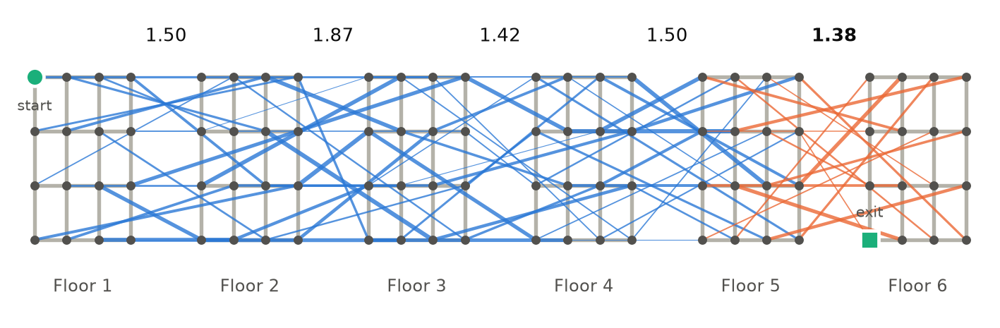
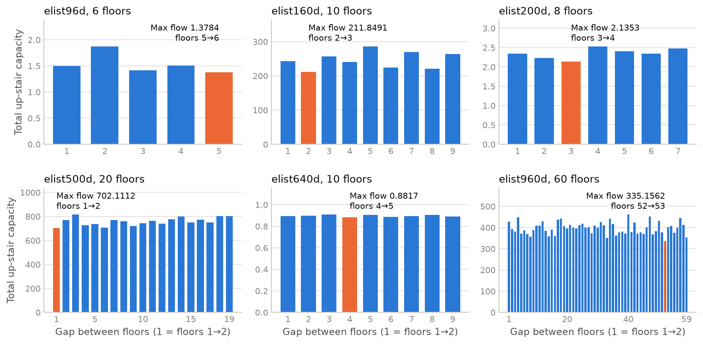
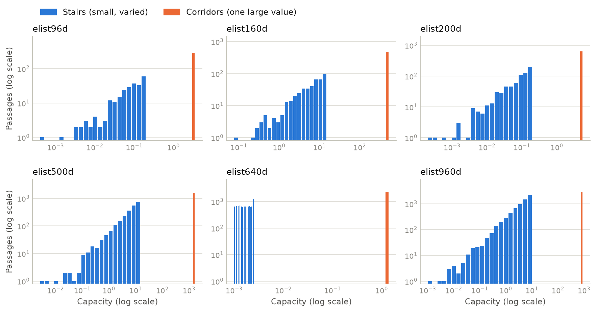
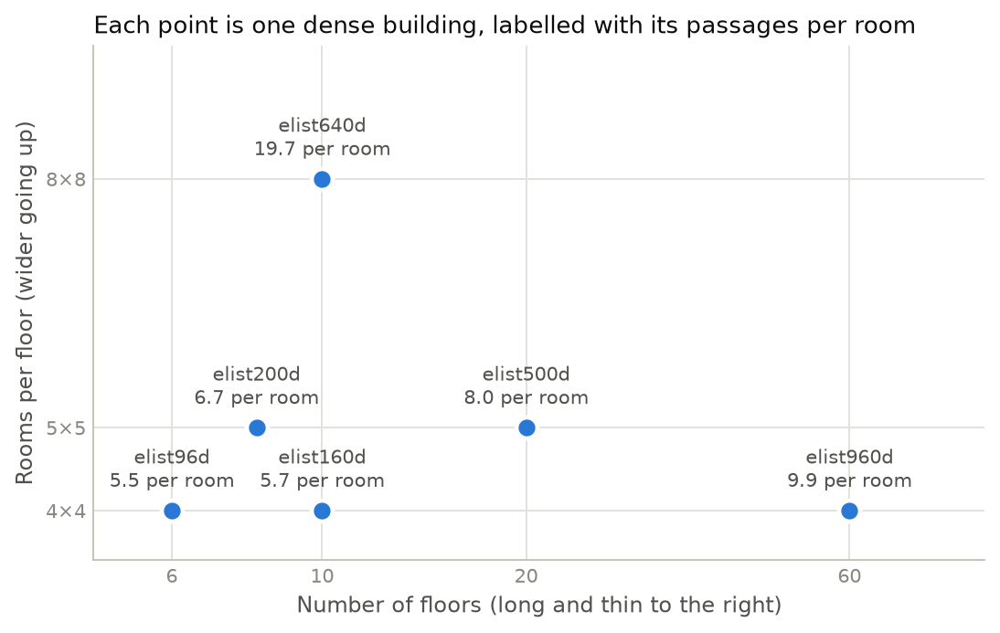
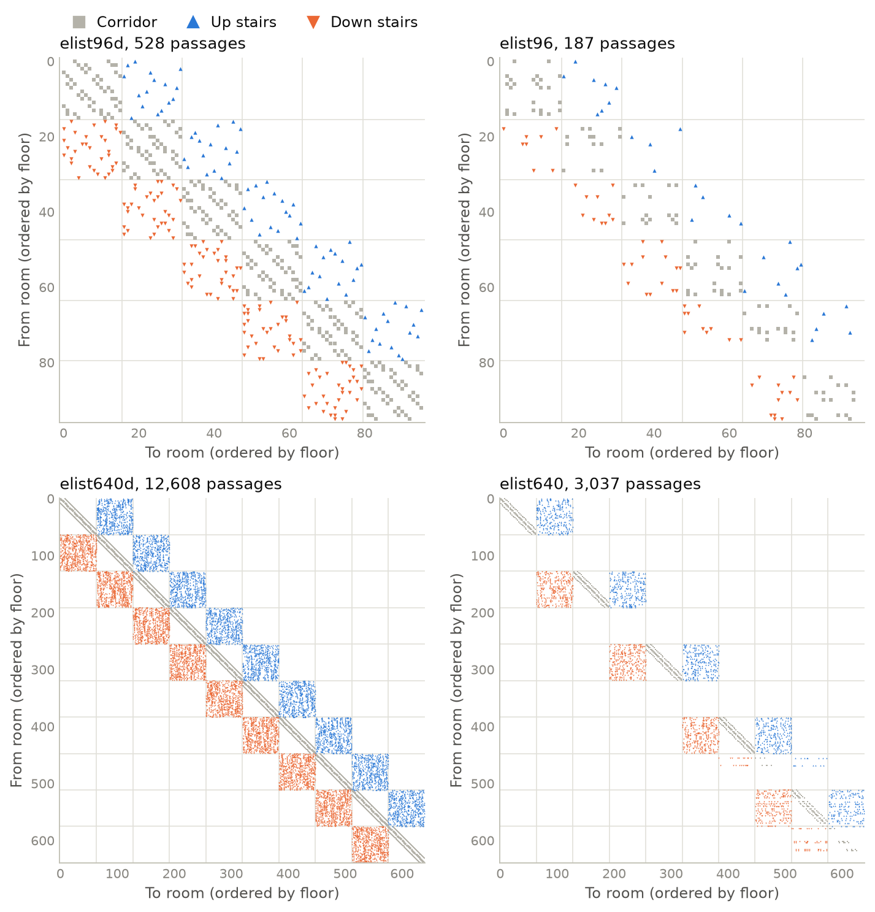
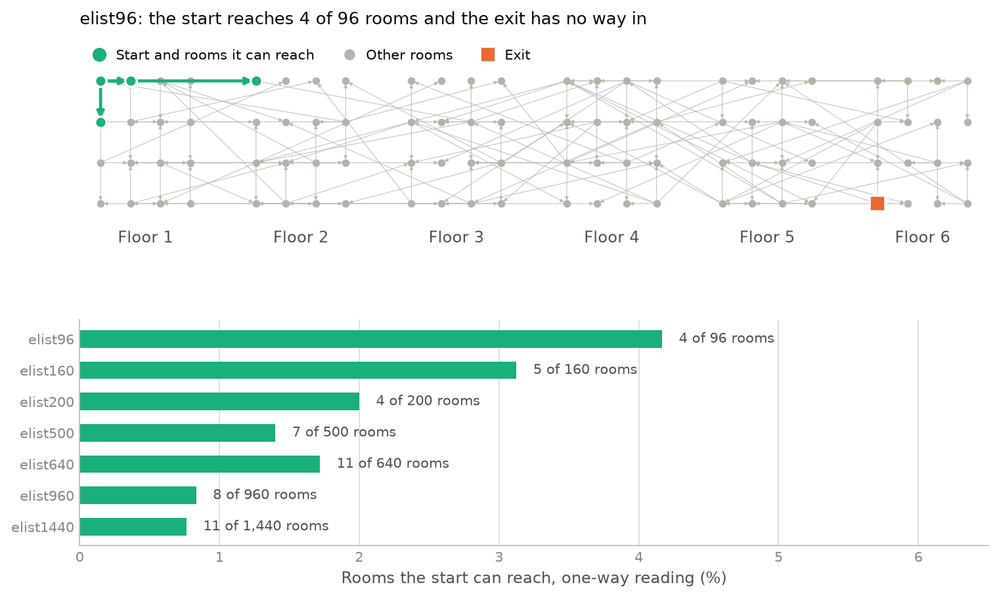
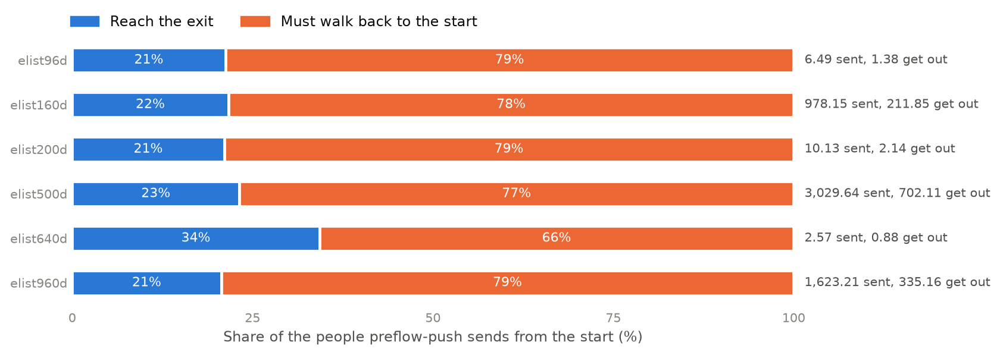

# Data model and analysis design

Groundwork for the maximum-flow study, written before any solver code (2026-11-08). The report's data
and method sections will be built from this document.

Every number and figure here comes directly from the 14 data files, with NetworkX as the source of
max-flow values. Phase 1 reproduced all of them from project code (Section 13): the tables are
checked by `tests/test_instance.py` and `tests/test_structure.py`, the cards are in
`results/data_cards.csv`, and the figures are drawn by `scripts/make_data_figures.py`.

The author approved the design choices in this document on 2026-11-09. Everything here is either a
measurement or an approved decision.

**How to read the language.** Explanations use a building analogy: floors are frames, rooms are nodes,
corridors are arcs inside a frame, stairs are arcs between frames, and people per minute stands for
capacity. A *passage* is any corridor or stair. The analogy is an explanation only. The networks are
synthetic and capacities have no units.

## 1. The data at a glance

| Group | Files | Directed max flow | Role |
|---|---|---|---|
| Buildings people can get through | 6 dense: 96d, 160d, 200d, 500d, 640d, 960d | positive | Main comparison |
| No route to the exit | 7 sparse: 96, 160, 200, 500, 640, 960, 1440; and 1440d | 0 | Reported separately |
| Two-way supplement | The same 7 sparse files, passages usable both ways | positive | Separate section |

That gives **21 data cases**: 14 files as listed, plus 7 sparse files under the two-way reading.

## 2. Source and format

The files match the `elist` test set of the Zuse Institute Berlin. They are synthetic "grids-on-pipe"
networks generated with RMFGEN (Goldfarb and Grigoriadis, 1988). Details and SHA-256 checksums are in
`../Data/SOURCES.md`.

Each file is whitespace-separated: n, m, s, t, then one `tail head capacity` per arc. Lines end in
CRLF and the last line has no line break.

Parsing rules:

- Read the whole file and split on any whitespace. Do not rely on column positions.
- Capacities appear in three formats (`3.200100e+00`, `3.20010`, `8.86000E-02`), sometimes within one
  file. Convert the text exactly, with no intermediate floating-point step.
- Node ids are used as given (1 to n).

## 3. Data quality audit

| Check | Result across all 14 files |
|---|---|
| Header m equals arcs read | 0 mismatches |
| Duplicate arcs (same tail and head) | 0 |
| Self-loops | 0 |
| Node ids outside 1 to n | 0 |
| Capacities that are zero or negative | 0 |
| Capacities with more than 4 decimals | 0 |
| s = 1 and t = n | holds in every file |
| Rooms with no passage at all | 0 |

Observations that are not errors, and are kept as they are:

- `elist1440d` is byte-for-byte identical to `elist1440`, and has no two-way pairs, unlike every other
  "d" file.
- All 7 sparse files have max flow 0 under the directed reading (Section 8).
- Dense files contain arcs entering s and leaving t (3 to 13 of each).

## 4. Instance inventory

Density is m / (n(n − 1)). "Two-way pairs" counts node pairs with arcs in both directions.

| File | n | m | Density | m/n | Two-way pairs | Distinct pairs | Out-arcs of s | In-arcs of t | Capacity min | Capacity max | Max flow |
|---|---|---|---|---|---|---|---|---|---|---|---|
| elist96 | 96 | 187 | 0.0205 | 1.95 | 0 | 187 | 3 | 0 | 0.0004 | 3.2001 | 0 |
| elist96d | 96 | 528 | 0.0579 | 5.50 | 151 | 377 | 3 | 3 | 0.0004 | 3.2001 | 1.3784 |
| elist160 | 160 | 285 | 0.0112 | 1.78 | 0 | 285 | 4 | 0 | 0.2624 | 480 | 0 |
| elist160d | 160 | 912 | 0.0358 | 5.70 | 261 | 651 | 4 | 5 | 0.0751 | 480 | 211.8491 |
| elist200 | 200 | 483 | 0.0121 | 2.42 | 0 | 483 | 3 | 1 | 0.0017 | 5.0001 | 0 |
| elist200d | 200 | 1,340 | 0.0337 | 6.70 | 340 | 1,000 | 3 | 3 | 0.0002 | 5.0001 | 2.1353 |
| elist500 | 500 | 1,040 | 0.0042 | 2.08 | 0 | 1,040 | 6 | 0 | 0.0206 | 1500 | 0 |
| elist500d | 500 | 3,975 | 0.0159 | 7.95 | 880 | 3,095 | 6 | 5 | 0.0026 | 1500 | 702.1112 |
| elist640 | 640 | 3,037 | 0.0074 | 4.75 | 0 | 3,037 | 10 | 2 | 0.001 | 1.2801 | 0 |
| elist640d | 640 | 12,608 | 0.0308 | 19.70 | 1,846 | 10,762 | 10 | 7 | 0.001 | 1.2801 | 0.8817 |
| elist960 | 960 | 2,061 | 0.0022 | 2.15 | 0 | 2,061 | 7 | 0 | 0.001 | 800 | 0 |
| elist960d | 960 | 9,488 | 0.0103 | 9.88 | 2,018 | 7,470 | 7 | 7 | 0.001 | 800 | 335.1562 |
| elist1440 | 1,440 | 5,397 | 0.0026 | 3.75 | 0 | 5,397 | 10 | 3 | 0.0002 | 720 | 0 |
| elist1440d | 1,440 | 5,397 | 0.0026 | 3.75 | 0 | 5,397 | 10 | 3 | 0.0002 | 720 | 0 |

## 5. Mathematical model

A file defines a directed network G = (N, A) with n = |N| rooms, m = |A| arcs, a capacity u_ij > 0 on
each arc, a source s and a sink t. The maximum flow problem (AMO Chapter 6, Lecture 3) is:

```
maximize    v
subject to  sum over j of x_ij  −  sum over j of x_ji  =   v   if i = s
                                                       =   0   if i is neither s nor t
                                                       =  −v   if i = t
            0 ≤ x_ij ≤ u_ij  for every arc (i, j)
```

How the data meets AMO's standing assumptions:

| Assumption | Requirement | How it is met |
|---|---|---|
| 6.1 | Network is directed | Main study: arcs as listed. Supplement: AMO Section 2.4 conversion |
| 6.2 | Capacities are nonnegative integers | Multiply by 10⁴ (at most 4 decimals), largest value 1.5 × 10⁷ |
| 6.3 | No s-t path of infinite-capacity arcs | All capacities are finite |
| 6.4 | If (i, j) exists, so does (j, i) | Add a reverse arc of capacity 0 where absent |
| 6.5 | No parallel arcs | Audit found none; the supplement creates none, as sparse files have no two-way pairs |

## 6. Residual network and the two readings

The algorithms work on the residual network, meaning how much more can still go each way along a
passage. Each node pair {i, j} has one pair of residual records:

```
r_ij = u_ij − x_ij + x_ji
```

Sending people from i to j lowers r_ij and raises r_ji by the same amount. Arc flows are recovered as
x_ij = max(u_ij − r_ij, 0). The structure therefore holds 2 × (distinct pairs) records, for example
754 for `elist96d` and 21,524 for `elist640d`.

| | Directed reading (main study) | Two-way reading (supplement) |
|---|---|---|
| Start values | r_ij = u_ij, and r_ji = u_ji or 0 | r_ij = r_ji = u_ij |
| Passage limit | 0 ≤ x_ij ≤ u_ij | \|x_ij − x_ji\| ≤ u_ij |
| m used in formulas | Arcs in the file | 2 × edges in the file |

## 7. The structure of the dense files

Every dense file is a chain of **floors**. Each floor is an exact a × a grid of rooms joined by two-way
corridors of one large capacity U. All other arcs are stairs that join neighbouring floors only. The
start is a corner room of the first floor and the exit is a corner room of the last.

| File | Floors L | Rooms per floor | Up stairs per room | Down stairs per room | Corridor U | Largest stair | Narrowest up-total | Widest up-total | Max flow | Narrowest gap | Shortest directed route (passages) |
|---|---|---|---|---|---|---|---|---|---|---|---|
| elist96d | 6 | 4×4 | 1 | 2 | 3.2001 | 0.1986 | 1.3784 | 1.871 | 1.3784 | 5→6 | 5 |
| elist160d | 10 | 4×4 | 2 | 1 | 480 | 14.9815 | 211.8491 | 285.8806 | 211.8491 | 2→3 | 9 |
| elist200d | 8 | 5×5 | 1 | 3 | 5.0001 | 0.1999 | 2.1353 | 2.5266 | 2.1353 | 3→4 | 9 |
| elist500d | 20 | 5×5 | 4 | 1 | 1500 | 14.994 | 702.1112 | 814.9268 | 702.1112 | 1→2 | 19 |
| elist640d | 10 | 8×8 | 8 | 10 | 1.2801 | 0.0025 | 0.8817 | 0.9081 | 0.8817 | 4→5 | 9 |
| elist960d | 60 | 4×4 | 5 | 2 | 800 | 9.999 | 335.1562 | 461.0198 | 335.1562 | 52→53 | 59 |



**Figure 1. `elist96d` as a building.** Grey lines are corridors, and coloured lines are up stairs drawn
with thickness proportional to capacity. Down stairs are omitted for clarity. Numbers show the total
up-stair capacity between floors, and the narrowest group is orange. The arrangement inside each floor
comes from the data; which corner appears where is arbitrary.

**Proposition.** Let F_k be the total capacity of up stairs from floor k to floor k + 1, and suppose
min F_k ≤ U. Then the maximum flow equals min F_k.

*Proof.* Upper bound: take S to be floors 1 to k. Stairs join neighbouring floors only, so the only
arcs leaving S are the up stairs of gap k. That cut has capacity F_k, so v ≤ F_k for every k.
Achievability: let v = min F_k. At each gap, choose flows on the up stairs that total v, each within
its capacity. Within any floor, the rooms now have inflows and outflows that balance overall. Corridors
connect every room in both directions, so route those imbalances along a spanning tree of the floor.
No corridor carries more than v, and v ≤ U, so the flow is feasible and has value v. ∎

Consequences:

- The max flow of every dense file can be found by adding and taking a minimum, with no solver. This
  is an independent check on the code. The condition holds in all six files, since U exceeds even
  the widest up-total.
- The minimum cut is always one whole gap between floors.
- Down stairs and corridors never limit the answer. They do affect how much work an algorithm does.
- The solvers are never told about floors. They see only a list of arcs, so floors are used for
  analysis alone.



**Figure 2. Bottleneck profile.** Each bar is one gap between floors, and the orange bar is the
narrowest. Its height is the max flow. Scales differ because capacities have no common unit. `elist640d`
is nearly flat, so many of its gaps are close to being the limit.



**Figure 3. Two kinds of passage.** Stairs have small, varied capacities. Corridors all share one value
that is far larger. Both axes are logarithmic. The corridor value is at least 16 times the largest
stair in every file.



**Figure 4. Shape of each building.** The six buildings range from long and thin (`elist960d`) to short
and wide (`elist640d`). These are the structural differences available to explain the results.

## 8. The sparse files and the supplement

Every sparse arc also appears in the matching dense file. Each room keeps either all of its dense
out-arcs or none (22% to 37% of rooms keep them). Some stairs have their capacity raised to U, and
none of the sparse files has a two-way pair. `elist1440` has no distinct dense companion, so its
floors cannot be identified.



**Figure 5. Grid of dots.** Each dot is one passage, with rooms ordered by floor and grey lines marking
floors. Dense files show corridors on the diagonal blocks, with up and down stairs beside them. The
sparse files keep the same pattern with large parts missing.

Under the directed reading no sparse file has any route from start to exit. Every room directly
reachable from the start is a dead end, and every room with direct access to the exit has no way in.



**Figure 6. Why the sparse files carry nothing.** The start reaches only itself and its immediate
neighbours. The largest share is 4% of rooms.

With two-way passages all seven carry people:

| File | Passages m after conversion | Max flow | Narrowest point | Shortest route (passages) |
|---|---|---|---|---|
| elist96 | 374 | 4.6653 | mid-building, 13 passages | 6 |
| elist160 | 570 | 970.3170 | at the exit, 3 passages | 10 |
| elist200 | 966 | 5.0001 | at the exit, 1 passage | 8 |
| elist500 | 2,080 | 3,013.5749 | at the exit, 3 passages | 20 |
| elist640 | 6,074 | 0.5477 | mid-building, 320 passages | 9 |
| elist960 | 4,122 | 61.3107 | mid-building, 16 passages | 59 |
| elist1440 | 10,794 | 111.0133 | mid-building, 360 passages | 9 |

The floor proposition does not apply here, because widened stairs and removed passages break its
conditions. NetworkX and the min-cut certificate provide the reference.

## 9. Modeling decisions

| # | Decision | Status | Why | Consequence |
|---|---|---|---|---|
| DM1 | Use every file exactly as given and directed | Decided | Author's rule; the files are lists of arcs | 8 of 14 files have zero flow |
| DM2 | Solve the 7 sparse files again as two-way, in a separate supplement | Decided | The source allows either reading; it adds 7 real tests | Results are never pooled with the main study |
| DM3 | Keep dense files directed only | Decided | Two-way pairs have different capacities, so a merging rule would have to be invented | Dense answers stay as in the files |
| DM4 | Scale capacities by 10⁴ to exact integers | Decided | Meets Assumption 6.2 and removes round-off | No tolerance needed; report divides by 10⁴ |
| DM5 | Keep arcs into s and out of t | Decided | They cannot change the max flow, and removing them alters the data | Value measured as net flow into t |
| DM6 | No preprocessing of any kind: no collapsing floors, no removing dead ends | Decided | Preprocessing would remove the very work being compared | Solvers face the full network |
| DM7 | Solvers do not use floor information | Decided | Floors are known to us, not given in the input | Floors are used for analysis only |
| DM8 | Keep file order as the baseline arc order, and test shuffled orders | Decided | Arc order changes the work done | Baseline is reproducible, shuffles measure sensitivity |
| DM9 | Report `elist1440d` as supplied, and not again in the supplement | Decided | Follows DM1; its identity with `elist1440` is a data fact | One extra zero-flow row, no extra supplement case |
| DM10 | Explain with floors and people, and report in AMO's terms | Decided | Author's choice | One statement in the report that the analogy is illustrative |

## 10. Analysis design

### 10.1 What is compared

| Variable type | Items |
|---|---|
| **Compared** | Algorithm and setting, listed below |
| **Measured** | Running time and operation counts (10.2) |
| **Held fixed** | Machine, Python version, single process, one reader and residual structure, starting arc order, seeds |
| **Used to explain** | n, m, density, m/n, floors, rooms per floor, stairs per room, narrowest gap, shortest route, max flow |

| Setting | Algorithm | Role |
|---|---|---|
| SAP | Shortest augmenting path as taught (AMO Figures 7.5, 7.6) | Headline |
| PP-FIFO | Preflow-push, oldest crowded room first | Headline |
| SAP+numb | SAP stopping early when a distance level empties | Tuned comparison |
| PP-FIFO+h | PP-FIFO with gap and global relabeling | Tuned comparison |
| PP-HL | Preflow-push, highest-label room first | Secondary: baseline order only |
| PP-HL+h | PP-HL with gap and global relabeling | Secondary: baseline order only |

Baseline order (file order, Phase 5): 21 data cases × 6 settings = 126 combinations. Shuffled orders
(Phase 6): the 13 data cases that carry flow × the 4 headline and tuned settings × 30 seeds. The
highest-label settings answer one question, whether a different preflow-push rule would change the
picture, and test P6; neither needs the shuffles (decided by the author, 2026-11-10).

### 10.2 Measures

| Measure | Exact definition | Applies to |
|---|---|---|
| Running time | `perf_counter` from just after the residual network is built until the algorithm stops, including its initial backward search; file reading and checking excluded | All |
| Passages checked | Every test of one residual record during search, relabel, flood, or backward search; checks in the starting backward search, and in global relabeling's searches, also reported separately | All |
| Room re-estimates | Relabel operations; rooms lifted by a gap or a global relabel counted separately, with the number of gap and global-relabel events | All |
| People movements | Every update of a residual pair, including preflow-push's opening flood | All |
| Augmentations, advances, retreats | Groups sent, steps forward, backups | SAP |
| Total route length | Sum of passages over all groups (equals SAP's people movements) | SAP |
| Work after the last group | Passages checked and relabels after the last augmentation (all of the run if there is none): effort spent proving no more people can get out, which `numb` cuts short (AMO p. 219). Added in Phase 3 | SAP |
| Saturating and non-saturating pushes | Saturating: the push fills its passage (δ = r_ij), even if it also empties the room. Non-saturating: otherwise, which always empties the room (AMO p. 225). The opening flood is counted separately, not as pushes | Preflow-push |
| Room visits | Node examinations (AMO Section 7.7) | Preflow-push |
| Walk-back work | Pushes from rooms with d(i) ≥ n, which can no longer reach the exit, and relabels that take a room to d(i) ≥ n | Preflow-push |
| Work after the maximum preflow | Pushes, relabels and passages checked after the last push into the exit (all of the run if there is none): from then on no more people get out (AMO p. 229). Added in Phase 4 | Preflow-push |

**Entry check.** Each run counts only if all of these hold: passage limits respected, people conserved
at every room except start and exit, min-cut certificate equal to the flow value, value equal to
NetworkX, and all six settings agree. On dense files the value must also equal the floor proposition.

### 10.3 Timing protocol

One discarded warm-up then 31 timed repeats per combination, with garbage collection off, the state
rebuilt untimed before each repeat, and run order shuffled to spread machine drift. Report the median
and interquartile range. Each result row records machine and library versions.

**Baseline run record (Phase 5, 2026-11-10).** Apple M2, 24 GiB, macOS 26.7.3, Python 3.11.8,
NetworkX 3.6.1; schedule seed 7372; 3,906 timed runs in 446 s, every answer checked. On the 13 cases
that carry flow, the interquartile range was a median 3.3% of the median time (largest 8.0%). Times
showed no drift across the schedule (median time ÷ combination median: 1.006, 1.000 and 0.999 in its
first, middle and last thirds). 39 repeats (1%) took more than twice their combination's median, 20 of
them on zero-flow runs lasting hundredths of a millisecond, where a brief pause by the operating
system dominates; medians are unaffected.

### 10.4 Deciding a winner (fixed before seeing results)

Applies to the 13 data cases that carry flow, using 30 seeded shuffles of each room's passage list,
for two pairs: SAP against PP-FIFO (headline) and SAP+numb against PP-FIFO+h (tuned).
Operation counts come from each seed, and time from 5 repeats per seed.

- **Primary measure:** median running time.
- **Secondary measure:** total work, meaning passages checked plus people movements.
- **Clear win:** the same algorithm is better in at least 27 of 30 shuffles, and the median ratio
  differs from 1 by at least 5%.
- Anything else is reported as **no clear winner**. A Wilcoxon signed-rank test is reported alongside.
- Precision applied in Phase 6 (`src/maxflow/winners.py`): the median ratio is taken on the log
  scale, exp(median(log(A / B))), so it is exactly symmetric, and "differs from 1 by at least 5%"
  means slower ÷ faster ≥ 1.05. The Wilcoxon test (two-sided) uses the paired log ratios.

Time and work are reported separately. If they disagree, the report says so and does not choose one.

Shuffles vary only the order of passages in a given building, so each conclusion applies to that
building.

**Shuffled run record (Phase 6, 2026-11-10).** Same machine as Phase 5; door-order seeds 1 to 30, each
its own timed block (schedule seed 7372 + order seed); 7,800 timed runs in 1,666 s, every answer
checked. The spread of each set of 5 repeats was a median 0.7% of its median time (95th percentile
5.3%); 10 repeats took more than twice their median; no door order ran systematically slower.
Results: `results/runs_shuffled.csv`, `results/times_shuffled.csv`, `results/winners.csv` (52
verdicts), `results/prediction_evidence.csv`, and figure R6 (`docs/figures/r6_shuffle_ratios.png`).

### 10.5 Predictions recorded before any solver runs

| # | Prediction | Basis |
|---|---|---|
| P1 | If worst-case bounds predicted practice, FIFO would beat SAP by a factor rising with m/n, from 5.5 to 19.7, most on `elist640d` | n²m against n³ |
| P2 | Every SAP group on a dense file walks at least the shortest route: 5, 9, 9, 19, 9, 59 passages | Section 7 |
| P3 | 66% to 79% of the people preflow-push sends must walk back, so walk-back work will be large | Figure 7 |
| P4 | On zero-flow files SAP makes no augmentations and stops after one backward search | Section 8 |
| P5 | On zero-flow files preflow-push does work only at the start and its immediate neighbours | Section 8 |
| P6 | Highest-label makes fewer non-saturating pushes than FIFO (tested at the baseline order only) | AMO p. 233 |
| P7 | Shortcuts help preflow-push more than SAP | AMO pp. 229–230 |



**Figure 7. How much must walk back.** Preflow-push begins by filling every passage out of the start.
The bars compare that amount with the max flow. Both numbers come straight from the files.

### 10.6 Questions the analysis answers

| Question | Evidence |
|---|---|
| Which is faster on each building? | Time and work, as taught and with shortcuts |
| Why? | Operation mix for each algorithm, against AMO's bottleneck operations |
| How do results change with size, density and shape? | Measures against n, m, m/n, floors and rooms per floor |
| How do actual counts compare with worst-case bounds? | Ratio of counts to n²m, n³ and n²√m |
| How much do shortcuts matter? | With against without, per algorithm |
| What happens on buildings with no route? | Separate table of zero-flow runs |
| Does the supplement agree? | Same analysis, own section |

### 10.7 Results files

Written by `scripts/run_benchmark.py` (Phase 5, file order). Phase 6 adds the shuffled orders.

**`results/runs_baseline.csv`**, one row per data case and setting (126 rows). Counters that do not
apply to an algorithm are left empty.

| Group | Columns |
|---|---|
| Identity | `timestamp, file, reading, group, n, m, density, setting, arc_order, schedule_seed` |
| Answer | `max_flow_scaled, max_flow, stop` (SAP only), `checks_passed` |
| Time, seconds | `time_median_s, time_q1_s, time_q3_s, time_min_s, time_max_s, repeats` |
| Shared work | `passages_checked, passages_checked_start_search, passages_checked_global, relabels, label_raises, gaps, global_relabels, people_movements, total_work` (passages checked + people movements) |
| SAP | `augmentations, advances, retreats, route_length_total, checks_after_last_group, relabels_after_last_group` |
| Preflow-push | `saturating_pushes, nonsaturating_pushes, flood_pushes, room_visits, walkback_pushes, walkback_relabels, max_label, checks_after_max_preflow, relabels_after_max_preflow, pushes_after_max_preflow` |
| Machine | `cpu, ram_gib, os, python, networkx` |

Every row has passed all entry checks: a failed check stops the run, so no unchecked row exists.
Quartiles use Python's `statistics.quantiles(..., method="inclusive")`.

**`results/times_baseline.csv`**, every timed repeat (3,906 rows): `position` (place in the shuffled
schedule), `file, reading, setting, repeat, time_s`. Used for spread figures and to check for drift.

## 11. Visualization plan

Data visualization carries the explanation in this study. Each figure answers one question.

**Data figures (done, in this document)**

| Figure | Question |
|---|---|
| 1. Floors and stairs | What does a building look like? |
| 2. Bottleneck profile | Where is the squeeze, and what is the max flow? |
| 3. Capacity groups | How different are corridors and stairs? |
| 4. Shape map | How do the buildings differ in shape? |
| 5. Grid of dots | What is the overall pattern, and what did sparse remove? |
| 6. Reachability | Why is the flow zero? |
| 7. Walk-back prediction | What should preflow-push have to undo? |
| 8. Mini building (`docs/mini_building.md`, Phase 2) | What does a best answer and its cut look like, small enough to check by hand? |

**Results figures (after the solvers exist)**

| Figure | Question | Form |
|---|---|---|
| R1 | Who is faster on each building? | Paired bars of median time with spread, log scale |
| R2 | Who does less work? | Paired bars of total work, one panel per measure |
| R3 | Where does the work go? | Stacked bars of each algorithm's operation mix |
| R4 | How close to the worst case? | Counts as a share of the bounds, per building |
| R5 | What do shortcuts change? | Before and after dumbbell for each setting |
| R6 | How consistent are the wins? | Share of 30 shuffles won, per building |
| R7 | Which shapes favour which algorithm? | Shape map marked with the winner |
| R8 | Where was the cut? | Figure 1 coloured by the final start side and exit side |
| R9 | How do the algorithms move people? | Step-by-step animation on the mini building (optional) |

**Rules for every figure**

- Generated by a script from saved numbers, never edited by hand.
- One colour meaning across the study, with a label or shape as well as colour.
- Rooms ordered by floor in any figure that shows rooms.
- Axes start at zero for bars on a linear scale, and any log scale is stated on the axis.
- Each file keeps its own scale where capacities differ, since they have no common unit.
- Supplement figures say "two-way reading" on the figure itself.

The figures in this document are drawn by `scripts/make_data_figures.py`.
The final report's main text uses only some of them, and the rest go to its appendix (see the "Final
report" part of `plan_of_action.md`, Section 5).

## 12. Threats to validity

| Threat | Effect | Handling |
|---|---|---|
| Only 6 main cases carry flow | Small evidence base | Report per building, with no general claim |
| One generator family | Results may not transfer to other networks | Conclusions limited to this family |
| Size, floors and stairs change together | Causes cannot be separated | Describe patterns, no causal claim; growth fits descriptive only |
| Python overhead | Time may hide operation differences | Report time and work together |
| Runs last milliseconds | Timing noise | 31 repeats, garbage collection off, shuffled order, spread reported |
| Arc-order luck | One order may favour one algorithm | 30 seeded shuffles |
| Implementation bias | One solver may be better written | Shared reader and structure, counters independent of the machine |
| Zero-flow files | Could distort averages | Reported separately |
| Supplement mixes in another reading | Could blur the main result | Own section, marked in every row and figure |
| Source files not confirmed identical to the archive | Provenance gap | Checksums recorded; stated in the report |

## 13. Acceptance checks for Phase 1

Status: **all five passed on 2026-11-09** (`pytest`, `scripts/survey_data.py`,
`scripts/make_data_figures.py`).

Phase 1 is complete when project code reproduces, from the raw files:

1. All audit results in Section 3, and all checksums in `../Data/SOURCES.md`.
2. Every row of the inventory in Section 4.
3. Every row of the structure table in Section 7, and the assertions that frames are exact grids and
   that stairs join neighbouring floors only.
4. The two-way table in Section 8.
5. Figures 1 to 7.
