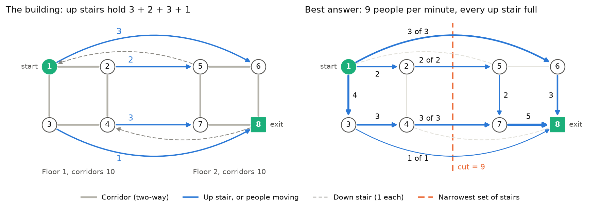

# The 8-room mini building

A building small enough to solve by hand, with every feature the real files have. Phase 2 uses it to
test the residual network and the verifier. Phases 3 and 4 will walk both algorithms through it step
by step, and the report uses it in Section 4 ("Running the algorithms").

File: `tests/data/mini_building.txt`, in the same format as the data files (n, m, s, t, then one
`tail head capacity` line per arc). It is made up for this study, so it is safe to commit.

**Figure 8. The mini building.** Left: capacities. Right: the best answer found by hand, with the
number of people on each passage and the narrowest set of stairs (orange). Drawn by
`scripts/make_data_figures.py`, which also runs the verifier on the drawn answer.

## The building

Two floors of 2 × 2 rooms. People start in room 1 and leave through room 8: n = 8 rooms, m = 22 arcs.

| Passages | Arcs | Capacity | Why it is there |
|---|---|---|---|
| Corridors 1–2, 1–3, 2–4, 3–4 and 5–6, 5–7, 6–8, 7–8 | 16 (each listed both ways) | 10 | The two-way pairs every real file has |
| Up stairs 1 → 6, 2 → 5, 4 → 7, 3 → 8 | 4 | 3, 2, 3, 1 | One up stair per room, as in `elist96d`, with small, varied sizes |
| Down stair 5 → 1 | 1 | 1 | A passage into the start (the dense files have 3 to 13) |
| Down stair 8 → 4 | 1 | 1 | A passage out of the exit (the dense files have 3 to 13) |

The floor finder (`maxflow.structure.find_floors`) recognises it as 2 floors of 2 × 2, and the stair
sum and NetworkX both give 9.

## The best answer, by hand

Four groups of people:

| Group | Route | People per minute |
|---|---|---|
| 1 | 1 → 6 → 8 | 3 |
| 2 | 1 → 2 → 5 → 7 → 8 | 2 |
| 3 | 1 → 3 → 4 → 7 → 8 | 3 |
| 4 | 1 → 3 → 8 | 1 |
| | **Total** | **9** |

People on each passage (all others carry nobody): 1 → 2: 2, 1 → 3: 4, 3 → 4: 3, 5 → 7: 2,
6 → 8: 3, 7 → 8: 5, and every up stair full (3, 2, 3, 1).

Every room except the start and exit sends out what comes in. For example, room 3 takes in 4 and
sends out 3 + 1, and room 7 takes in 2 + 3 and sends out 5.

**Why nobody can do better.** Every route from floor 1 to floor 2 climbs one of the four up stairs, and
together they hold 3 + 2 + 3 + 1 = 9. No flow can be larger than the capacity of any cut (AMO Property
6.1, Section 6.3), and here a flow of 9 sits next to a cut of 9, so both are optimal (Theorem 6.3,
Section 6.5). The two down stairs cross the same line but point back toward the start, so they do not
count: a cut's capacity counts only passages leaving the start's side.

## The residual network

Each pair of rooms joined by a passage gets two records: space left going one way, and space left
going back (AMO Section 2.4, Assumption 6.4). Records 2k and 2k + 1 are a pair. 14 pairs make 28
records. The table shows them after the best answer is in place.

| Records | Passage i → j | Capacity i → j / j → i | Space left i → j | Space left j → i |
|---|---|---|---|---|
| 0, 1 | 1 → 2 | 10 / 10 | 8 | 12 |
| 2, 3 | 1 → 3 | 10 / 10 | 6 | 14 |
| 4, 5 | 2 → 4 | 10 / 10 | 10 | 10 |
| 6, 7 | 3 → 4 | 10 / 10 | 7 | 13 |
| 8, 9 | 5 → 6 | 10 / 10 | 10 | 10 |
| 10, 11 | 5 → 7 | 10 / 10 | 8 | 12 |
| 12, 13 | 6 → 8 | 10 / 10 | 7 | 13 |
| 14, 15 | 7 → 8 | 10 / 10 | 5 | 15 |
| 16, 17 | 1 → 6 | 3 / 0 | 0 | 3 |
| 18, 19 | 2 → 5 | 2 / 0 | 0 | 2 |
| 20, 21 | 4 → 7 | 3 / 0 | 0 | 3 |
| 22, 23 | 3 → 8 | 1 / 0 | 0 | 1 |
| 24, 25 | 5 → 1 | 1 / 0 | 1 | 0 |
| 26, 27 | 8 → 4 | 1 / 0 | 1 | 0 |

How to read three of the rows:
- **Corridor 1–2.** 2 people went 1 → 2, so the space left that way is 10 − 2 = 8, and the way back
  gains 2: 10 + 2 = 12.
- **Stair 1 → 6.** It is full (0 left), and the 3 people on it could be sent back, so 6 → 1 has 3.
- **Down stair 5 → 1.** Unused, so 1 is left going down, and there is no stair going 1 → 5.

**Room lists.** Each room lists the records that leave it, in the order the pair first appears in the
file. This order decides which passage an algorithm tries first.

| Room | Leads to, in order |
|---|---|
| 1 | 2, 3, 6, 5 |
| 2 | 1, 4, 5 |
| 3 | 1, 4, 8 |
| 4 | 2, 3, 7, 8 |
| 5 | 6, 7, 2, 1 |
| 6 | 5, 8, 1 |
| 7 | 5, 8, 4 |
| 8 | 6, 7, 3, 4 |

**Reading the answer back out.**
- People on each file arc: x = max(u − r, 0). For example, corridor 1 → 2 gives 10 − 8 = 2, and its
  reverse 2 → 1 gives max(10 − 12, 0) = 0.
- Net people into the exit: the sum, over records leaving room 8, of (space left − capacity):
  (13 − 10) + (15 − 10) + (1 − 0) + (1 − 1) = 3 + 5 + 1 + 0 = 9.

## What the verifier finds

On the best answer every check passes. The rooms the start can still reach are floor 1, {1, 2, 3, 4},
because every up stair is full and neither down stair can be climbed the wrong way. The passages
leaving that set hold 9, equal to the answer, which proves it is optimal.

The tests (`tests/test_verify.py`) also break the answer on purpose, and the verifier names each fault:

| Broken answer | Verifier message starts with |
|---|---|
| 4 people on stair 1 → 6 (holds 3) | passage limit |
| −1 people on down stair 8 → 4 | passage limit |
| Only 2 people leave room 6 for the exit | conservation: room 6 takes in 3 but sends out 2 |
| Correct people, answer reported as 10 | value |
| Group 4 left out, answer 8 | not maximum: ... along 1 -> 3 -> 8, which has space for 1 more |
| One arc's value missing | length |
| 2 people sent 1 → 2 without crediting the way back | bookkeeping |

## Shortest augmenting path, step by step (Phase 3)

The algorithm as taught (AMO Figures 7.5 and 7.6, Lecture 3). Each room's **distance label** d is an
estimate of how many passages it takes to reach the exit. A passage is **admissible** (usable now) if
it has space left and leads to a room whose label is exactly one lower. Rooms try their passages in
the order of the room lists above.

**Starting labels** come from a backward search from the exit: the fewest passages from each room to
room 8.

| Room | 1 | 2 | 3 | 4 | 5 | 6 | 7 | 8 |
|---|---|---|---|---|---|---|---|---|
| d | 2 | 3 | 1 | 2 | 2 | 1 | 1 | 0 |

| Step | What happens | People out |
|---|---|---|
| 1 | Advance 1 → 3 → 8 and send **1**. Stair 3 → 8 is now full | 1 |
| 2 | Advance 1 → 3. Room 3 has no admissible passage: relabel it from 1 to 3, step back | 1 |
| 3 | Advance 1 → 6 → 8 and send **3**. Stair 1 → 6 is full | 4 |
| 4 | Room 1 has none: relabel it from 2 to 4. It is the start, so there is no step back | 4 |
| 5 | Advance 1 → 2 → 4 → 7 → 8 and send **3**. Stair 4 → 7 is full | 7 |
| 6 | Advance 1 → 2 → 4. Relabel room 4 from 2 to 4, step back to room 2 | 7 |
| 7 | Advance 2 → 5 → 6 → 8 and send **2**. All four up stairs are full | **9** |
| 8 | Advance 1 → 2. Relabel room 2 from 3 to 5, step back | 9 |
| 9 | Advance 1 → 3. Relabel room 3 from 3 to 5. Now no room has label 3 | 9 |

**With `numb`, it stops at step 9.** No room is left at distance 3, so the rooms above the gap
(1, 2, 3 and 4, all of floor 1) are cut off from the rooms below it (AMO pp. 219–220). That gap is
exactly the narrowest set of stairs found by hand.

**As taught, it carries on** until d(1) reaches n = 8, with five more relabels: room 1 to 6, room 4
to 6, room 2 to 7, room 3 to 7, and room 1 to 8. So 7 of its 10 relabels happen after everyone is
already out. This is the waste AMO describes on p. 219.

The four groups it finds differ from the hand-worked ones, but carry the same 9. Their routes are
2, 2, 4 and 4 passages long, never shorter than the group before (a consequence of AMO Lemma 7.5).

| Counter | As taught | With `numb` |
|---|---|---|
| Groups sent (augmentations) | 4 | 4 |
| People movements (total route length) | 12 | 12 |
| Steps forward (advances) | 19 | 16 |
| Steps back (retreats) | 7 | 3 |
| Relabels | 10 | 5 |
| ... of which after the last group | 7 | 2 |
| Passages checked | 119 | 81 |
| ... of which in the backward search | 28 | 28 |
| ... of which after the last group | 51 | 13 |

`tests/test_sap.py` checks every row of the step table and the counters above, in both settings.

## Preflow-push (FIFO), step by step (Phase 4)

The algorithm as taught (AMO Figures 7.11 and 7.12, Lecture 3) with the FIFO rule (AMO Section 7.7).
Instead of sending complete groups, it lets crowds build up inside rooms and then clears them.

**Flood.** Every passage out of the start is filled to capacity: 10 people into room 2, 10 into room 3
(the two corridors) and 3 into room 6 (the stair). That is 23 people, but only 9 can ever get out, so
**14 must eventually walk back** to the start. The start's label becomes n = 8. The starting labels of
the other rooms are the same as for shortest augmenting path.

A room holding people is **crowded** and waits in line. Each **visit** pushes people through admissible
passages (to a room whose label is one lower) until the room is empty or has none left; then the
room is relabeled and goes to the back of the line.

| Visit | Room (people, label) | What happens | Line afterwards | Out |
|---|---|---|---|---|
| | | Flood | 2, 3, 6 | 0 |
| 1 | 2 (10, 3) | Push 10 → 4, filling corridor 2 → 4 | 3, 6, 4 | 0 |
| 2 | 3 (10, 1) | Push 1 → 8, filling stair 3 → 8. Relabel 1 → 3 | 6, 4, 3 | 1 |
| 3 | 6 (3, 1) | Push 3 → 8 | 4, 3 | 4 |
| 4 | 4 (10, 2) | Push 3 → 7, filling stair 4 → 7. Relabel 2 → 4 | 3, 7, 4 | 4 |
| 5 | 3 (9, 3) | Relabel 3 → 5 | 7, 4, 3 | 4 |
| 6 | 7 (3, 1) | Push 3 → 8 | 4, 3 | 7 |
| 7 | 4 (7, 4) | Push 7 → 2 | 3, 2 | 7 |
| 8 | 3 (9, 5) | Push 9 → 4 | 2, 4 | 7 |
| 9 | 2 (7, 3) | Push 2 → 5, filling stair 2 → 5. Relabel 3 → 5 | 4, 5, 2 | 7 |
| 10 | 4 (9, 4) | Relabel 4 → 6 | 5, 2, 4 | 7 |
| 11 | 5 (2, 2) | Push 2 → 6 | 2, 4, 6 | 7 |
| 12 | 2 (5, 5) | Relabel 5 → 7 | 4, 6, 2 | 7 |
| 13 | 4 (9, 6) | Push 9 → 3 | 6, 2, 3 | 7 |
| 14 | 6 (2, 1) | Push 2 → 8. **Everyone who can get out is out** (the maximum preflow) | 2, 3 | **9** |
| 15 | 2 (5, 7) | Push 5 → 4 | 3, 4 | 9 |
| 16 | 3 (9, 5) | Relabel 5 → 7 | 4, 3 | 9 |
| 17 | 4 (5, 6) | Relabel 6 → 8: room 4 can no longer reach the exit | 3, 4 | 9 |
| 18 | 3 (9, 7) | Relabel 7 → 9 | 4, 3 | 9 |
| 19 | 4 (5, 8) | Push 5 → 2 | 3, 2 | 9 |
| 20 | 3 (9, 9) | Push 9 → 1: back to the start | 2 | 9 |
| 21 | 2 (5, 7) | Relabel 7 → 9 | 2 | 9 |
| 22 | 2 (5, 9) | Push 5 → 1: back to the start. Nobody is crowded, so it stops | | 9 |

The first 14 visits get the 9 people out. The last 8 visits only walk the other 14 back, by raising
the labels of rooms 2, 3 and 4 past the start's label of 8. That is the walk-back work that
prediction P3 is about.

**With the heuristics switch**, the run is the same until visit 9. There, room 2's relabel from 3 to 5
leaves no room at label 3 (room 3 had already left it at visit 5), so the gap rule lifts rooms 2, 3
and 4 straight to n = 8. Those three rooms plus the start are floor 1: the narrowest set of stairs
again. The walk back then starts at once, and the run needs 17 visits instead of 22.

| Counter | FIFO | FIFO + heuristics | Highest-label | Highest-label + heuristics |
|---|---|---|---|---|
| Room visits | 22 | 17 | 26 | 16 |
| Saturating pushes | 4 | 4 | 5 | 5 |
| Non-saturating pushes | 11 | 9 | 15 | 9 |
| Relabels | 10 | 7 | 9 | 5 |
| Gaps (rooms lifted) | 0 | 1 (3) | 0 | 1 (3) |
| Walk-back pushes / relabels | 3 / 3 | 3 / 3 | 2 / 2 | 1 / 1 |
| Pushes after the maximum preflow | 4 | 2 | 0 | 0 |
| Passages checked | 115 | 95 | 115 | 82 |

Highest-label clears the highest rooms first, which here are the ones walking back, so the last
person reaches the exit at the very end of its run. Every setting gets the same 9 people out.

`tests/test_preflow.py` checks every push and relabel in the visit table, the gap, and the FIFO
counters. The highest-label column comes from the code, which the verifier and NetworkX check.
